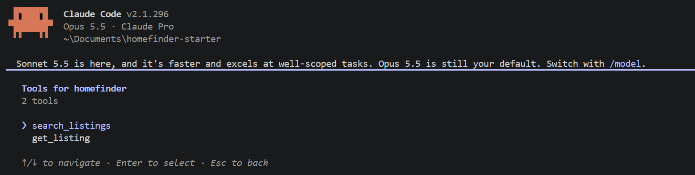
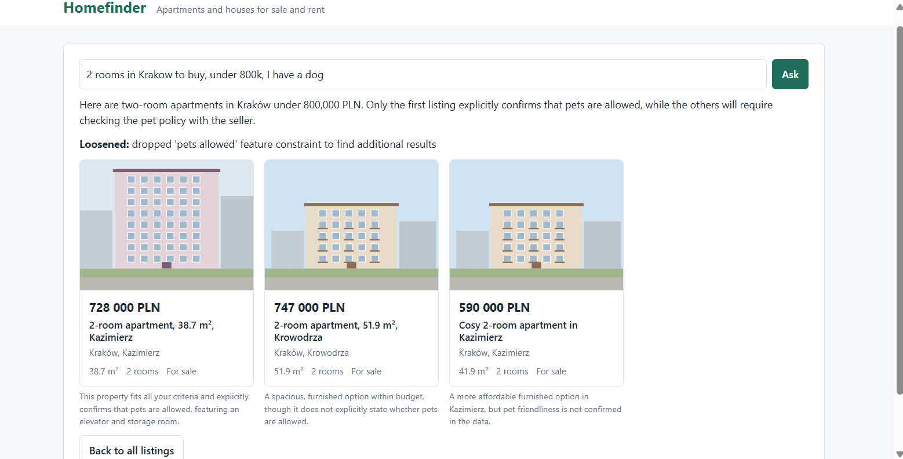
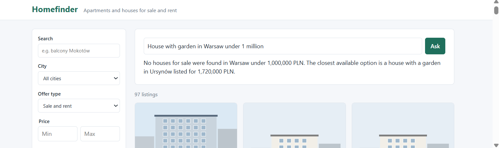

# Homefinder

My solution to the task "Improve an existing real estate product".

The starter looked like it worked, but the data underneath was unreliable: prices stored as text, six cities spelled ten ways, three duplicate listings, and listings that contradict themselves (floor 14 of 4, an area of 3.45 m², a flat for sale at 4,500 PLN). Search, and any AI feature built on that data, would give wrong answers with confidence.

So I put the data first. One rule runs through the whole project: **fix what is unambiguous, flag what would be a guess, and never hide either from the user.**

- **Ingest** cleans the 100 listings with tested rules, keeps doubtful values unchanged and flags them (15 listings).
- **Search** is one function used by the website, the MCP server and the assistant, so all three give the same answers.
- **The page** shows a warning on flagged listings instead of presenting them as fact.
- **The assistant** turns a request in plain language into a shortlist, passes the warnings on, and says when it loosened something you asked for.
- **Evals** check that behaviour with code against the database: 9 of 9 scenarios pass, and most of them come from failures I found while testing.

What I left out, and why, is in section 3. Each decision, with the alternatives I rejected, is in [docs/DECISIONS.md](docs/DECISIONS.md).

## How to run it

You need Node.js 22.12 or newer and npm.

```bash
npm install
cp .env.example .env      # Windows: copy .env.example .env
npm run ingest            # builds the database from data/listings.raw.json
npm run dev               # website on http://localhost:5173, API on http://localhost:3001
```

**The app runs without an API key.** To turn on the assistant and the evals, add a Gemini key and a model to `.env`:

```
GEMINI_API_KEY=your-key
GEMINI_MODEL=gemini-3.6-flash
```

| Command | What it does |
|---|---|
| `npm run check` | Type check and unit tests |
| `npm run eval` | Runs the agent scenarios against the real model |
| `npm run mcp` | Starts the MCP server. `.mcp.json` registers it for Claude Code |
| `npx tsx scripts/audit.ts` | Prints a read-only report of problems in the raw data |

A note on keys: one question to the assistant makes several model calls, and a full eval run made 31 to 35. On Gemini's free tier I was limited to 20 requests per model per day, which is not enough for an eval run. My results are saved in [docs/EVAL_RESULTS.md](docs/EVAL_RESULTS.md). The MCP server needs no key.

---

## 1. What problems I identified

Before changing anything, I had Claude Code write a script that only reads the data and lists what's wrong. The full list is in [docs/DATA_AUDIT.md](docs/DATA_AUDIT.md).

**The data could not be trusted.** In 100 listings I found:

- prices and areas stored as text: `"460 tys. zł"`, `"PLN 740,000"`, `"199 m2"`
- six cities spelled ten ways: `kraków`, `Kraków ` (with a space), `Gdansk`, `WROCŁAW`
- three duplicates: the same flat posted twice, a repost with a lower price, and the same flat listed by two agents
- listings that contradict themselves: floor 14 of 4; an area of 3.45 m²; "without a lift" in the text but "elevator" in the features; a flat for sale at 4,500 PLN
- one price in EUR, Polish feature names mixed with English ones, a missing image file, a publication date in 2027

**Search was hard to use.** It matched one exact piece of text. "Mokotow" did not find Mokotów. Two words together found nothing. The price filter mixed sale and rent. There was no sorting, and no way to describe what you want in your own words.

**The code hid the problems.** There was no backend and no tests. The TypeScript types said every price was a number, so text prices passed through the filters unnoticed.

## 2. What I chose to work on, and why

I worked in this order. Each decision, with the alternatives I rejected, is in [docs/DECISIONS.md](docs/DECISIONS.md).

1. **Data first.** Search, the page and an assistant are all wrong if the data underneath is wrong. A script (`npm run ingest`) checks every listing, cleans it with fixed rules and stores it in SQLite. My main rule: **fix what is unambiguous, flag what would be a guess.** "460 tys. zł" becomes 460000. A flat priced at 5.95 million in Łódź keeps its price and gets a warning, because I cannot know the right value.
2. **One search for everything.** A single search function that ignores capitals and Polish accents, matches several words, filters by features, sorts, and knows that "Warszawa" means Warsaw. The website, the MCP server and the assistant all call this same function, so they cannot disagree.
3. **Show the warnings.** A "Check details" badge on listing cards and a "Things to verify" box on the listing page, written for users.
4. **AI on top.** An MCP server and a search assistant. More on these below.

## 3. What I deliberately left out

- **A UI framework, accounts, maps, pagination, deployment.** None of them helps with the problems above.
- **Embeddings and vector search.** With about 100 structured listings, exact filters are precise and easy to test. The model's job is to turn a sentence into filters.
- **A comparison page, price statistics, currency conversion.**
- **A district dropdown.** Districts are found through text search.
- **A second LLM provider.** I did not add code I could not test.
- **Custom Claude Code skills.** `CLAUDE.md` was enough for a project this size.

Known issues are listed in [docs/DECISIONS.md](docs/DECISIONS.md). The ones a user would notice: the feature checkboxes need layout polish, typos in the search box are not corrected, and the assistant takes a few seconds and answers one request at a time.

## 4. How my changes improve the product

| Before | After |
|---|---|
| 10 entries in the city filter for 6 cities | 6 entries |
| 100 listings, 3 of them duplicates | 97 unique listings |
| Prices shown as "1 096 000 zł PLN" | Clean prices |
| "Mokotow" finds nothing | Finds the Mokotów listing |
| "balcony Żoliborz" finds nothing | Finds both matching listings |
| "Floor 14 of 4" shown as a fact | 15 listings carry a warning that says what to verify |
| The newest-first list started with a listing dated 2027 | Values I do not trust no longer decide the order |
| Filters only | You can also describe what you want in a sentence |

The ingest result on the real data: 100 read, 100 stored, 0 rejected, 3 duplicates marked, 15 listings flagged.

**Technical state.** There is now a small backend (Hono) with a SQLite database. All SQL is in one file. External data is validated at every boundary: the raw file, API parameters and tool inputs. The cleaning rules, the duplicate detection, the search, the API, the tools and the agent loop have unit tests, and the cleaning tests use the real dirty values from the file.

## 5. How I would measure whether it works

- **Product:** how many searches return nothing; how many people go from search to a listing and on to "Send an email"; how often the assistant is used and how often one of its suggestions is opened.
- **Data:** the share of listings that pass validation, the number of flags per 100 listings, and the number of rejected records per ingest.
- **AI:** the eval pass rate, the number of model calls and the time per request, and the cost per request.

## 6. How I used AI during development

I built this with **Claude Code**, one small task at a time, and used a **separate Claude chat** to plan the steps and review output before accepting it.

My routine for each step: ask for the plan or the tests first, read them, let it implement, run `npm run check`, read the diff, then run the real thing and read the output myself.

[docs/AI_LOG.md](docs/AI_LOG.md) is my step-by-step record, including the prompts I kept and every place the AI got something wrong. Three examples:

- **It ignored a project rule and two instructions, and the tests still passed.** It used type casts on external data, which `CLAUDE.md` forbids, and skipped two things I had asked for. I found this by comparing the diff with my prompt.
- **A test that checked nothing.** Sorting from high to low put "Price on request" first. The test for it passed because its loop ran zero times. I found the bug by reading the code.
- **A wrong summary.** It reported 16 flagged listings and "everything matches". The real output showed 15.

What I learned: passing tests do not prove the instruction was followed, and a summary from the model is a claim to check.

## 7. How the AI harness and the agentic functionality work

### The harness

- **[CLAUDE.md](CLAUDE.md)** is the context every Claude Code session reads: goals, commands, architecture, data rules, what is out of scope and how to work in the repo.
- **[docs/DECISIONS.md](docs/DECISIONS.md)** records each decision with its alternatives and its cost, so a new session does not propose what I already rejected.
- **`.mcp.json`** registers the project's own MCP server, so Claude Code can search the listings while I work.
- **Feedback:** `npm run check` after every change, and `npm run eval` after a change to the agent or the tools.

Every session starts with the same prompt: read the context, summarise what is built, change nothing. That was enough for a fresh session to notice where an earlier one had drifted from my rules. It found a real bug that way: a single `null` record would have stopped the whole import.

### How the pieces connect

```
data/listings.raw.json
        |   npm run ingest: check, clean, flag, mark duplicates
        v
   SQLite database
        |
        v
   one search function (src/core/search.ts)
        |
        +--> API ----------------> website
        +--> tools --> MCP server -> any MCP client (for example Claude Code)
                   \-> agent ------> assistant panel on the website
```

### Tools and the MCP server

There are two tools, defined once in `server/tools.ts`:

- `search_listings` returns at most 10 short summaries and the total number of matches
- `get_listing` returns the full details of one listing

The tools are plain code with no model inside. The MCP server (`server/mcp.ts`) makes them available to any MCP client.

I tested it from Claude Code by asking for 2-room flats for sale in Kraków under 800,000 PLN. With no other instructions it searched, opened the two cheapest, and advised against the cheapest one because its area says 23.1 m² in one place and 37 m² in another. A flag from my data cleaning changed the recommendation.



### The agent

**Its goal:** turn a request in plain language into a shortlist of up to five listings, each with a reason, plus warnings where the data is doubtful.

It's a simple loop built directly on the Gemini SDK, no framework (`server/agent.ts`):

- The model can call the two tools. It must finish by calling a third one, `submit_shortlist`.
- It gets at most 8 model calls. On the last one it can only submit, so it always gives an answer.
- **Nothing the model says is trusted.** If it asks for a tool that does not exist or gives an invalid answer, it is told so and continues. Ids that don't exist, or that point to a listing marked as a duplicate, are removed.
- It returns listing ids, a reason for each, and short notes (warnings, what it loosened). Prices, areas and the "Check details" badge always come from the database, not from the model.
- Rules in its instructions: something the person needs (a dog, a car) becomes a filter; if it loosens a requirement it says so; it states only what the data confirms; when nothing fits it says what the closest option costs.

Everything specific to Gemini sits in one small adapter, so another provider would mean one more adapter.

A request where the data only partly confirms what the person needs. One flat lists pets as allowed; for the others it says so, and it says which requirement it loosened:



A request nothing fits. It says so, and names the closest option from the data:



### Showing that it works: evals

`npm run eval` sends nine realistic requests to the real agent. Each has rules the answer must meet, and the rules are checked by code against the database: the listings exist, are in the right city, match the request, flagged listings are named in a warning, the agent finished, and it didn't try to submit any id that had to be removed. No second model grades the answers, The answers are checked by plain code, not by another AI.

Most scenarios come from failures I found while testing by hand:

- The first real run told someone with a dog that four flats were suitable. Only one lists pets as allowed. I changed the instructions and made that question a scenario.
- A request for a house in Warsaw returned nothing. I assumed the agent was at fault. The trace showed it was my search, which did not know the name "Warszawa".

**Results:** 8 of 9 on the first full run, 9 of 9 after the fixes, on `gemini-3.6-flash`. Details are in [docs/EVAL_RESULTS.md](docs/EVAL_RESULTS.md).

**What the evals do not check:** whether the written reasons are good. One scenario passed with a poor answer until I made its rules stricter, so I still read the answers.

### What testing found, and where I fixed it

A wrong answer from an AI feature is not always the model's fault. For each problem I read the trace of tool calls first, then fixed it where the cause was.

| What went wrong | Cause | Fix |
|---|---|---|
| It said four flats suit a dog; only one lists pets as allowed | The instructions did not say what to do with a stated need | Instructions: a need becomes a filter, and loosening it must be said |
| It added details that are not in the data ("green walking areas") | Nothing told it to stay with the facts | Instructions: only what the tool results say |
| A request with no possible match ended with "could not be completed" | It kept searching until it ran out of steps | Code: the last step is a forced answer; instructions: at most three searches |
| A request for a house in "Warszawa" found nothing | My search did not know the Polish city name | Search code: city aliases. The tool also returns the known cities when it gets one it does not know |
| "The cheapest flat in Warsaw" skipped two cheaper studios, and the eval still passed | It filtered on "apartment"; my eval rule was too loose | Instructions: "flat" includes studios. Eval: the cheapest listing is now required |
| The free tier ran out after about three questions | 20 requests per model per day, several model calls per question | Moved to a paid tier; noted the limit above |

## 8. What I would do next

**For users**

- Follow-up questions in the assistant ("cheaper ones", "what about Podgórze")
- A comparison tool, so the assistant can set listings side by side. Tools are defined in one place, so adding one is a single entry that the MCP server and the agent both pick up
- Price guidance: let the assistant say whether a price is fair compared with similar listings
- An exact room-count filter, typo tolerance in search, and a "did you mean" when a search finds nothing
- For duplicate offers, show both agents' contacts and the price history
- Saved searches and alerts, and a Polish version of the site
- Its own scroll area for the filter sidebar, and pagination once there are more than a few hundred listings

**For the data**

- A review queue where a person checks flagged and rejected listings
- Adding or updating single listings without rebuilding everything
- Using a model to suggest new cleaning rules from the descriptions. A person decides, and the rules stay fixed code
- Postgres, and filtering in SQL, when the data grows

**For the AI parts**

- More eval scenarios, each run several times, and a model-based check for the quality of the reasons
- Running the evals automatically, with tracing and cost per request
- A second LLM provider, and a remote MCP server with authentication
- Browser tests for the assistant panel and the filters

---

## Where things are

```
data/listings.raw.json   the original data, never edited
scripts/                 audit.ts (report) and ingest.ts (raw data -> database)
src/core/                shared logic: types, cleaning, duplicates, search
src/                     the website (plain TypeScript)
server/                  database, API, tools, MCP server, agent
evals/                   scenarios, grader, runner
docs/                    decisions, data audit, AI log, eval results
```